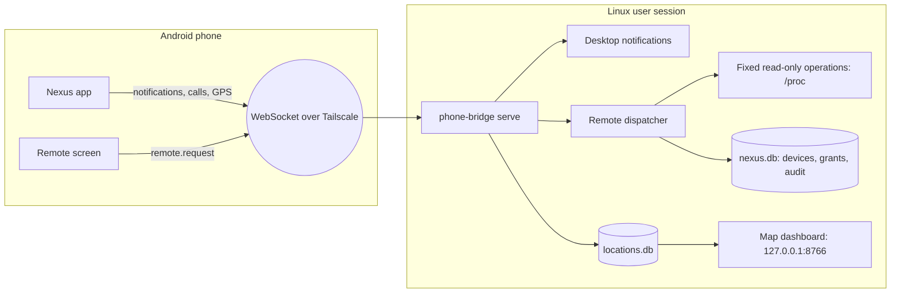

# Nexus

**Your Android phone and your Linux computer, privately connected.**
Nexus forwards phone notifications, calls, GPS location and battery to your Linux desktop,
and lets a *paired* phone check on that computer: system status and a read-only process
view. Everything travels over your own [Tailscale](https://tailscale.com) network; there is
no cloud service.

> **Status: 0.3.0-alpha1 (Nexus Remote 0.1 alpha).** For testers. Not a production-grade
> security product. Linux (Arch/Manjaro, Ubuntu) + Android 8.0+ only.
>
> **Formerly PhoneBridge.** Existing PhoneBridge installs upgrade in place; see
> [Migrating from PhoneBridge](#migrating-from-phonebridge).

## Features

| Area | What it does |
|---|---|
| Notifications | Forwards messaging, email and social notifications to the Linux desktop (allow-list, filters) |
| Calls | Ringing / answered / ended alerts on the desktop |
| GPS + battery | Opt-in location sharing, stored in local SQLite, live map dashboard, GPX/GeoJSON export |
| **Nexus Remote** | From the phone: CPU, memory, disk, load, uptime, a sortable process list and per-process details. **Read-only.** |
| Identity | Per-device credentials, explicit permissions, instant revoke/rotate, audit log |

**Nexus Remote cannot:** run commands, open a shell, read or write files, stop or signal
processes, use root/sudo, or see command lines, environment variables or other users'
names. These are not hidden settings: no such operation exists in this release.

## How it works



- The Linux agent runs as **your user** (systemd user service, `NoNewPrivileges`).
- Each phone has its own credential. The legacy shared token still works for
  notifications/calls/GPS but **can never** use Remote.
- Every remote request is checked on Linux: device still valid → permission granted →
  operation allow-listed → parameters valid → rate/concurrency limits → timeout → output cap
  → audit row.
- The map dashboard is local (`127.0.0.1`) and has no remote-control routes.

Design and security details: [`docs/architecture/NEXUS_REMOTE_DESIGN.md`](docs/architecture/NEXUS_REMOTE_DESIGN.md),
[`docs/security/NEXUS_REMOTE_THREAT_MODEL.md`](docs/security/NEXUS_REMOTE_THREAT_MODEL.md),
[`docs/protocol/REMOTE_PROTOCOL.md`](docs/protocol/REMOTE_PROTOCOL.md).

## Requirements

- Linux with Python **3.11+** and systemd. Tested: Arch/Manjaro, Ubuntu 24.04. Ubuntu 22.04
  ships Python 3.10: install `python3.11 python3.11-venv` and run `PYTHON=python3.11 ./scripts/install.sh`.
- Android **8.0+** (API 26).
- Tailscale on both devices, signed in to the same tailnet (recommended; any private
  network works but traffic is plain WebSocket, so do not expose it to the internet).

## Install (Linux)

### Arch / Manjaro

```bash
sudo pacman -S --needed python tailscale
git clone https://github.com/p1ll3chan/Nexus.git && cd Nexus/phone-bridge
./scripts/install.sh
```

Or build a system package: `cd packaging/arch && makepkg -si`, then as your user run
`phone-bridge init-config` and `systemctl --user enable --now phone-bridge`.

### Ubuntu

```bash
sudo apt install python3 python3-venv
# Tailscale: https://tailscale.com/download/linux
git clone https://github.com/p1ll3chan/Nexus.git && cd Nexus/phone-bridge
./scripts/install.sh
```

The installer never uses root. It creates `~/.local/share/phone-bridge/venv`, writes
`~/.config/phone-bridge/config.toml` (mode 0600) bound to your Tailscale IP when it can
detect it, and enables the `phone-bridge` systemd **user** service. Re-run it to update.

## Pair your phone

1. Install the app: build it (`cd android && ./gradlew :app:assembleDebug`, APK in
   `android/app/build/outputs/apk/debug/`) or use a release APK.
2. On Linux, create a device and grant read access:

   ```bash
   phone-bridge remote pair my-phone --grant remote.read
   ```

   It prints a credential like `dev_3f9a…​.Xk2…` **once**. Treat it like a password.
3. In the app: enter the Linux computer's Tailscale IP, paste the credential into
   **Nexus device credential**, tap **Save & connect**, grant the permissions you want.
4. Tap **Open Nexus Remote**.

The credential is stored on the phone encrypted with an Android Keystore key. On Linux only
a SHA-256 hash is kept.

## Permissions

| Permission | Allows | 0.1 status |
|---|---|---|
| `remote.read` | `system.status`, `process.list`, `process.inspect` | available |
| `remote.execute` | approved actions (none exist yet) | grantable, unused |
| `remote.scripts` | admin-approved scripts | **deferred**, cannot be granted |

Permissions default to **denied**, are exact strings (no wildcards) and are checked on Linux
for every request. GPS sharing is a separate phone-side toggle and is unrelated to Remote.

```bash
phone-bridge remote devices                      # list devices + permissions
phone-bridge remote grant   <device-id> remote.read
phone-bridge remote ungrant <device-id> remote.read
phone-bridge remote rotate  <device-id>          # new credential, old one stops working
phone-bridge remote revoke  <device-id>          # disconnects within 5 s, removes grants
phone-bridge remote revoke-all                   # panic button
phone-bridge remote audit                        # who asked for what, when, outcome
phone-bridge remote ops                          # the fixed operation list
phone-bridge remote run system.status            # try an operation locally
```

Re-pairing a phone creates a new identity with **no** permissions.

## Remote operations

| Operation | Parameters | Returns |
|---|---|---|
| `system.status` | none | CPU %, cores, load, memory, disks (by label), uptime, kernel |
| `process.list` | `limit` 1–200, `offset`, `sort_by` memory/cpu_time/pid/name, `order`, `own_only` | PID, name, state, own/other, memory, CPU time, threads, start time |
| `process.inspect` | `pid`, optional `start_ticks` (PID-reuse guard) | the above plus parent PID, nice, virtual memory |

Example exchange (see [`docs/protocol/REMOTE_PROTOCOL.md`](docs/protocol/REMOTE_PROTOCOL.md)):

```json
→ {"type":"remote.request","v":1,"request_id":"a1b2c3d4e5f60718","operation":"system.status","params":{},"ts":1795440000.5}
← {"type":"remote.event","v":1,"request_id":"a1b2c3d4e5f60718","state":"accepted","ts":1795440000.6}
← {"type":"remote.response","v":1,"request_id":"a1b2c3d4e5f60718","operation":"system.status","status":"completed","result":{"host":"arch-laptop","cpu":{"percent":12.5,"count":8},…}}
```

## Privacy

- Location sharing is **off unless you enable it** on the phone; GPS history stays in
  `~/.local/share/phone-bridge/locations.db` and is pruned after `location_retention_days`.
- The remote audit log (`nexus.db`) stores **metadata only**: time, device, operation,
  decision, outcome and a hash of the parameters. It never stores results, process names,
  notification text or coordinates. It is pruned after `audit_retention_days` (90).
- Notification and call content is shown on your desktop and written to the agent log.
  Keep the log private, or lower `log_level`.
- Nothing is sent to any third party. The dashboard loads map tiles from OpenStreetMap/CARTO
  in your browser when you open it.

## Files

| Path | Contents |
|---|---|
| `~/.config/phone-bridge/config.toml` | settings + legacy token (0600) |
| `~/.local/share/phone-bridge/locations.db` | GPS history |
| `~/.local/share/phone-bridge/nexus.db` | devices (hashed secrets), grants, approvals, audit (0600) |
| `~/.config/systemd/user/phone-bridge.service` | user service |

## Uninstall

```bash
cd Nexus/phone-bridge
./scripts/uninstall.sh            # keeps config and data
./scripts/uninstall.sh --purge    # also deletes GPS history, devices, audit log
```

Revoke the phone first (`phone-bridge remote revoke-all`) if you keep the data, then remove
the app from the phone.

## Troubleshooting

| Symptom | Fix |
|---|---|
| Agent will not start: "token is still the shipped placeholder" | `phone-bridge token`, paste into `config.toml`, or remove the line and pair devices |
| Phone stays "Reconnecting" | Check `host` in `config.toml` is the Tailscale IP (or `0.0.0.0`), `tailscale status` shows both devices, port 8765 not firewalled |
| "authentication failed" | Credential mistyped, rotated or revoked: `phone-bridge remote devices`; pair again if needed. Ten failures per minute lock that address out briefly |
| Remote screen: "uses the legacy shared token" | Paste a device credential into the app; the shared token never unlocks Remote |
| Remote screen: "no remote permission" | `phone-bridge remote grant <device-id> remote.read` |
| "Request rejected as stale" | Phone and computer clocks differ by more than 5 minutes; enable automatic time |
| Process shows "PID now belongs to a different process" | It exited and the PID was reused; refresh the list |
| Logs | `journalctl --user -u phone-bridge -f` |

## Migrating from PhoneBridge

- Same Android package (`com.phonebridge.app`), same config path, same `phone-bridge`
  command (plus a `nexus` alias), same `locations.db`. Notifications, calls and GPS keep
  working with your existing shared token.
- **Breaking:** the literal placeholder token `change-me` is now rejected.
- **Breaking:** the dashboard's `/api/locate` only accepts `POST` (the built-in button already does).
- To use Remote, pair the phone (above). When every phone is paired, set
  `legacy_token_auth = false` (or `legacy_token_expires = "YYYY-MM-DD"`).

## Limitations (0.1 alpha)

- Read-only diagnostics only; no actions, scripts or file access.
- WebSocket is not TLS; confidentiality relies on Tailscale (WireGuard). Do not port-forward it.
- Single Linux user per agent; approvals are approved on that Linux account.
- No pairing QR code yet: the credential is copied by hand.
- The Android Remote UI has JVM unit tests and Lint, but no instrumented UI tests yet.
- Not audited by a third party. Do not rely on it to protect high-value systems.

## Development

```bash
cd phone-bridge && python3 -m unittest discover -s tests -t .      # Linux agent (124 tests)
cd android && ./gradlew :app:testDebugUnitTest :app:assembleDebug  # Android (26 tests)
```

Shared protocol fixtures: `protocol/fixtures/remote/` (used by both test suites).
Reports: `docs/NEXUS_REGRESSION_MATRIX.md`, `docs/security/NEXUS_SECURITY_TEST_REPORT.md`.

## License

Apache License 2.0. See [LICENSE](LICENSE) and [NOTICE](NOTICE).
