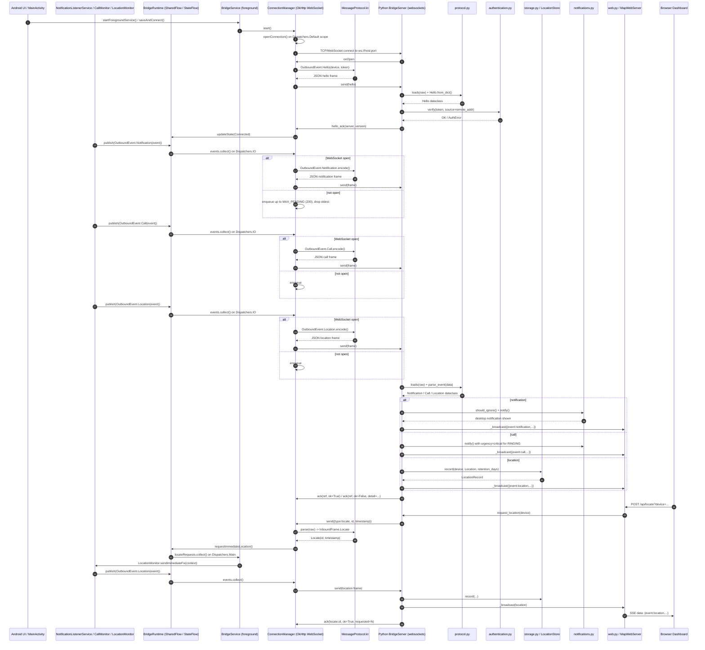

# PhoneBridge Message Flow

> **Date:** 2026-11-12<br>
> **Scope:** Document the existing message lifecycle for notifications, calls, and GPS telemetry from the Android UI/service to the Python server, SQLite persistence, and dashboard broadcast; plus the reverse locate-request path. No source code was modified. Missing behaviour is explicitly marked as **unknown**.

## 1. Legend

- **TX / RX:** Sender / receiver of a frame.
- **Flow step:** The number in the Mermaid diagram.
- **Thread/coroutine:** Kotlin `Dispatchers.IO`, Kotlin `MainThread`, Python `asyncio`, Android binder/system thread, etc.
- **Reconnect:** How that hop tolerates transient failures.
- **Error handling:** What happens when parsing, I/O, or validation fails.

## 2. Sequence Diagram (Mermaid)



## 3. Hop-by-Hop Breakdown

### 3.1 Android sources → `BridgeRuntime` (outbound events)

| # | Source file | Class / function | Trigger | Message shape | Thread / context | Error handling | Notes |
|---|---|---|---|---|---|---|---|
| 1a | `NotificationBridgeListener.kt` | `NotificationBridgeListener.onNotificationPosted(sbn: StatusBarNotification)` | System posts a notification the user has allowed the app to read. | `NotificationEvent(app, title, text, packageName, id, ongoing, lowPriority, timestamp)` | Android binder thread of the `NotificationListenerService`. | `tryEmit` failure logs and drops; empty title/text returns early; social-only filter may skip. | Reads `StatusBarNotification.extras` for `EXTRA_TITLE`, `EXTRA_TEXT`, `EXTRA_BIG_TEXT`, `EXTRA_SUMMARY_TEXT`; timestamp from `sbn.postTime / 1000.0`. |
| 1b | `CallMonitor.kt` | `CallMonitor.handle(context, state, number)` | Telephony state change (`CALL_STATE_IDLE`/`RINGING`/`OFFHOOK`). | `CallEvent(state, name="", number, id, timestamp)` | `TelephonyCallback`/`PhoneStateListener` callback thread (main executor for API 31+, else listener thread). | `SecurityException` logged; repeated same state ignored. | API 31+ does not receive the phone number; pre-API 31 `PhoneStateListener` does. |
| 1c | `LocationMonitor.kt` | `LocationMonitor.emitLocation(context, location)` | GPS/network/fused provider update or immediate locate response. | `LocationEvent(latitude, longitude, accuracy, battery?, charging, altitude?, speed?, bearing?, provider, id, timestamp)` | `LocationListener.onLocationChanged` callback on the main looper (requested with `Looper.getMainLooper()`). | Individual provider registration failures are caught and logged; if no provider registers, nothing is emitted. | `timestamp` is `Location.time / 1000.0` when available, else `MessageProtocol.now()`. Battery is read from sticky `ACTION_BATTERY_CHANGED` intent or `BatteryManager`. |
| 1d | `MainActivity.kt` | `MainActivity.sendTestNotification()` | User taps "Send test" button. | Same notification/call/location events as above. | Android main thread; `lifecycleScope` not used for emission. | Falls back to hardcoded San Francisco coordinates if immediate fix unavailable. | Test-only path. |

Common next hop for all outbound events:

| # | File | Function | What it does | Context | Error / backpressure |
|---|---|---|---|---|---|
| 2 | `BridgeRuntime.kt` | `BridgeRuntime.publish(event: OutboundEvent): Boolean` | Emits into `MutableSharedFlow<OutboundEvent>` with `extraBufferCapacity = 256`, `replay = 0`. | Called from any thread (Flows are thread-safe). | `tryEmit` returns `false` if buffer full; callers log drops and update stats. |

### 3.2 `BridgeRuntime` → WebSocket wire

| # | File | Class / function | What it does | Context | Reconnect | Error handling |
|---|---|---|---|---|---|---|
| 3 | `ConnectionManager.kt` | `ConnectionManager.start()` | Launches collector on `BridgeRuntime.events` in `Dispatchers.IO`; calls `openConnection()`. | `BridgeService` `SupervisorJob() + Dispatchers.Default` scope. | see below. | If already running, CAS returns. |
| 4 | `ConnectionManager.kt` | `dispatch(event: OutboundEvent)` | If `open.get()` and `webSocket.send()` returns true → sent; else enqueues in `pending` `ArrayDeque`. | Invoked inside the collector coroutine (`Dispatchers.IO`). | n/a inside dispatch; reconnect loop handles connection loss. | If queue exceeds 200, oldest dropped and `notificationsSkipped` stat incremented. |
| 5 | `MessageProtocol.kt` | `OutboundEvent.encode()` → `MessageProtocol.notification()` / `call()` / `location()` | Builds `JSONObject`, puts fields, returns JSON string. | Same collector thread. | n/a | Unknown malformed events are not produced by the sealed type; JSON construction can throw but is not caught here. |
| 6 | `ConnectionManager.kt` | `OkHttpClient` WebSocket send | Sends UTF-8 text frame. | OkHttp internal writer thread. | OkHttp internal retries are enabled (`retryOnConnectionFailure(true)`). | If `send()` returns false, event is re-enqueued at front. |

### 3.3 WebSocket → Python server handshake

| # | File | Class / function | What it does | Context | Error handling | Notes |
|---|---|---|---|---|---|---|
| 7 | `server.py` | `BridgeServer.handler(websocket)` | Per-connection coroutine; calls `_handshake()`, then `_read_loop()`. | `asyncio` task created by `websockets.serve`. | Handshake failure sends error frame and returns; unhandled exceptions are logged. | Remote address taken from `websocket.remote_address[0]`. |
| 8 | `server.py` | `_handshake(websocket, address)` | Waits up to `HELLO_TIMEOUT` (10 s) for first frame; validates it is `hello`; checks `enabled_devices`; verifies token via `Authenticator`. | Same `asyncio` task. | `hello_timeout`/`bad_hello`/`device_not_allowed`/`auth_failed` error frames sent; session not created. | Auth failures are rate-limited per source IP by `authentication.py`. |
| 9 | `authentication.py` | `Authenticator.verify(candidate, source, device)` | Constant-time HMAC compare; per-source sliding-window rate limit (default 10 failures / 60 s). | Same coroutine. | Raises `AuthError` on mismatch or lockout; history recorded. | Source extracted from connection remote address. |
| 10 | `protocol.py` | `loads(raw)` + `Hello.from_dict(data)` | JSON parse, validate required fields, length limits. | Same coroutine. | Raises `ProtocolError` on invalid JSON, missing type, or bad types. | `device` and `token` are required strings; `version`/`platform` have defaults. |
| 11 | `server.py` | Sends `hello_ack` + creates `ClientSession` | Stores session in `self.sessions[websocket]`. | Same coroutine. | n/a | Also starts per-connection `_heartbeat()` task. |

### 3.4 Python server inbound event dispatch

| # | File | Class / function | What it does | Context | Error handling | Notes |
|---|---|---|---|---|---|---|
| 12 | `server.py` | `_read_loop(websocket, session)` | `async for raw in websocket`; parses and dispatches to handlers. | Same `asyncio` task per connection. | `ProtocolError` logs warning, sends `error` frame, continues. Non-`ProtocolError` exceptions propagate to `handler()` and end the connection. | `parse_event` returns `Notification`, `Call`, `Location`, `Locate`, `Ping`, `Pong`, `Hello`. |
| 13 | `protocol.py` | `parse_event(data)` / per-type `from_dict()` | Validates frame and converts to dataclass. Length/range checks apply; timestamps use `float()` directly for some types (see risks). | Same coroutine. | `ProtocolError` raised; malformed non-dict, missing type, unsupported type, or out-of-range coordinates rejected. | `Location` validates lat/lon/accuracy/speed/bearing; `Notification`/`Call` truncate long strings. |
| 14 | `server.py` | `_handle_notification()` | Logs full title/text; checks `allow_notifications`; filters via `NotificationService.should_ignore()`; emits desktop notification; broadcasts to dashboard listeners; sends `ack`. | Same coroutine, notification delivery via `asyncio.to_thread` for D-Bus. | D-Bus/`notify-send` failures are logged; dashboard broadcast uses best-effort queue drop. | Logs sensitive content at INFO level. |
| 15 | `server.py` | `_handle_call()` | Logs state + caller name/number; checks `allow_calls`; emits desktop notification with urgency `critical` for `RINGING`; broadcasts; sends `ack`. | Same coroutine. | Same as notification. | Caller identity logged at INFO. |
| 16 | `server.py` | `_handle_location()` | Logs exact coordinates; checks `allow_location`; writes to SQLite via `asyncio.to_thread`; broadcasts `LocationRecord`; sends `ack`. | Same coroutine, DB I/O offloaded to thread. | DB exceptions propagate to `handler()` and close the connection. | Retention pruning uses the phone-supplied `timestamp`, not `received_at`. |
| 17 | `storage.py` | `LocationStore.record(device, event, retention_days=0)` | Inserts row into SQLite `locations` table; runs `DELETE WHERE timestamp < cutoff` when `retention_days > 0`. | Background thread (via `asyncio.to_thread`) under `threading.Lock`. | Exceptions bubble up. | WAL mode + synchronous=NORMAL. No explicit file/directory permissions are set. |
| 18 | `server.py` | `_broadcast(payload)` | Puts event dict into each subscribed `asyncio.Queue`; drops oldest if full. | Called from the connection coroutine. | Best effort; individual full queues drop events. | Subscribers are dashboard SSE clients via `MapWebServer`. |
| 19 | `notifications.py` | `NotificationService.notify()` / backend send | Resolves D-Bus / `notify-send` / console backend; applies icon mapping and filtering. | Mostly async; D-Bus uses `asyncio.to_thread`. | Backend errors logged; falls through. | Subprocess call is argument-list based (`create_subprocess_exec`), not shell. |

### 3.5 Dashboard broadcast path

| # | File | Class / function | What it does | Context | Error handling | Notes |
|---|---|---|---|---|---|---|
| 20 | `web.py` | `MapWebServer._handle_client(reader, writer)` | Parses HTTP request line/headers; routes to API handlers. | `asyncio` task per TCP connection. | Request timeouts and connection errors silently ignored; other exceptions logged. | No authentication; CORS set to `*` for SSE. |
| 21 | `web.py` | `_stream_events(writer)` | Subscribes to `BridgeServer`; writes SSE `data:` lines. | Same `asyncio` task. | Connection errors end the stream; unsubscribe in `finally`. | Sends keepalive `: keepalive\n\n` every 15 s. |
| 22 | `web.py` | `_build_status()` / `_build_locations()` / export handlers | Reads `LocationStore`; returns JSON, GeoJSON, GPX. | Same task (DB calls may block event loop; observed in tests). | Invalid query values suppressed. | `/api/locate` accepts both GET and POST without authentication. |

### 3.6 Reverse path: locate request (dashboard → phone)

| # | File | Class / function | What it does | Context | Error handling | Notes |
|---|---|---|---|---|---|---|
| 23 | Browser | `locateBtn` click handler | `fetch('/api/locate?device=...', {method:'POST'})`. | JavaScript event loop. | Button text shows failure; no retry. | No CSRF token. |
| 24 | `web.py` | `/api/locate` handler | Calls `bridge.request_location(device)` if bridge attached. | `asyncio` task. | Returns `{"ok": true, "requested": N}` even if 0 devices. | GET is also accepted for a state-changing request. |
| 25 | `server.py` | `request_location(device=None)` | Builds `locate_request()` frame and sends to all matching sessions. | Called from web request coroutine; sends over each target WebSocket. | `ConnectionClosed` returns false for that send; count reflects successful sends. | If `device` omitted, broadcasts to all connected phones. |
| 26 | `protocol.py` | `locate_request()` / `Locate.to_dict()` | Produces `{"type":"locate","id":"...","timestamp":...}`. | n/a | n/a | ID is random UUID hex. |
| 27 | `ConnectionManager.kt` | `SocketListener.onMessage()` → `MessageProtocol.parse()` → `InboundFrame.Locate` | Parses frame; calls `BridgeRuntime.requestImmediateLocation()`. | OkHttp reader thread. | Unknown/malformed frames become `InboundFrame.Unknown` and are logged. | If `auth_failed`/`device_not_allowed` error received, `attempt` is set to at least 4 to slow retry. |
| 28 | `BridgeRuntime.kt` | `requestImmediateLocation()` | Emits `Unit` into `MutableSharedFlow<Unit>` (`locateRequests`). | OkHttp reader thread. | `tryEmit` may fail if buffer full (16 slots). | |
| 29 | `BridgeService.kt` | `locateJob` collector | Collects on `Dispatchers.Main`; calls `LocationMonitor.sendImmediateFix(this@BridgeService)`. | `BridgeService` coroutine scope, main dispatcher. | Cancellation caught by scope. | |
| 30 | `LocationMonitor.kt` | `sendImmediateFix(context)` | Requests a single current location fix (API 30+ via `getCurrentLocation()` + main executor); falls back to last-known. | Main-thread callback from `LocationManager`. | `SecurityException` avoided by prior permission check; failures return `false`. | Result flows back through `emitLocation()` → `BridgeRuntime.publish()` → `ConnectionManager` → server → dashboard, completing the loop. |

### 3.7 Heartbeats and keepalive

| Direction | File | Mechanism | Interval / timeout | Action on failure |
|---|---|---|---|---|
| Server → phone | `server.py` `_heartbeat()` | Sends `ping` frame; waits for `pong` event on session. | interval = `max(5, heartbeat_interval)` (default 25 s); timeout = `max(interval*2, heartbeat_timeout)` (default 70 s). | Closes WebSocket with code 1001. Client then reconnects. |
| OkHttp → server | `ConnectionManager.kt` `OkHttpClient.Builder.pingInterval(20, SECONDS)` | RFC 6455 WebSocket ping/pong at TCP layer. | 20 s | OkHttp handles internally; if connection dead, `onFailure` is invoked and reconnect scheduled. |
| Phone application | `ConnectionManager.kt` `SocketListener.onMessage()` | Replies to server `ping` with `OutboundEvent.Pong`. | On receive. | n/a |

## 4. Reconnect Behaviour Summary

| Layer | File / function | Behaviour |
|---|---|---|
| Android `ConnectionManager` | `ConnectionManager.kt` `scheduleReconnect()` | Exponential backoff from 5 s to 60 s plus 0–1 s jitter; capped at attempt shift ≤ 5. `attempt` reset to 0 on successful `hello_ack`. Pending queue flushed on `hello_ack`. Reconnect stops when `running` is false. |
| OkHttp | `OkHttpClient.Builder` | `retryOnConnectionFailure(true)`; `pingInterval(20s)`; connect timeout 10 s; write timeout 15 s; read timeout 0 (infinite, because frames are expected continuously). |
| Python server | `websockets.serve()` | Per-connection handler task; no automatic client reconnect (server-side). Server continues listening. |
| SSE dashboard | `web.py` `_stream_events()` | Browser `EventSource` auto-reconnects on error; server sends `: keepalive\n\n` every 15 s. |

## 5. Error Handling Summary

| Layer | Failure mode | Handling |
|---|---|---|
| Android UI | Invalid host/port/token | `BridgeSettings.isConfigured()` false; `ConnectionManager` logs required fields and stays in Retrying state. |
| Android listeners | Missing permissions | `CallMonitor` catches `SecurityException`; `LocationMonitor` checks permission and logs warning; `NotificationBridgeListener` requires system-granted access. |
| `BridgeRuntime` | Buffer full (256 events) | `tryEmit` returns false; caller drops and logs. |
| `ConnectionManager` | Send while disconnected | Enqueue to pending (max 200); oldest dropped on overflow. |
| `ConnectionManager` | Any connection failure | `scheduleReconnect()` with exponential backoff. |
| `MessageProtocol.kt` | Invalid inbound JSON / unknown type | Returns `InboundFrame.Unknown(type, raw)`; logged as debug. |
| Python handshake | Timeout / bad hello / auth fail | Sends `error` frame; closes connection; rate-limit bucket updated. |
| Python `_read_loop` | `ProtocolError` | Logs warning, sends `error` frame, continues reading. |
| Python `_read_loop` | Non-`ProtocolError` exception | Propagates to `handler()`, logged, connection ends. |
| Python storage | DB error | Propagates from `asyncio.to_thread`, ends connection. |
| Python dashboard | HTTP parse/timeout/connection error | Silently closes writer; generic exceptions logged. |

## 6. Message Shapes

All frames are JSON objects with a `type` field.

### 6.1 Outbound (Android → Python)

#### `hello`

```json
{
  "type": "hello",
  "device": "Pixel-9",
  "token": "<shared-secret>",
  "version": 1,
  "platform": "android"
}
```

- Source: `MessageProtocol.hello()` (`MessageProtocol.kt:24-30`).
- Sent by: `ConnectionManager.SocketListener.onOpen()` (`ConnectionManager.kt:136-138`).

#### `notification`

```json
{
  "type": "notification",
  "id": "<uuid-hex>",
  "app": "WhatsApp",
  "package": "com.whatsapp",
  "title": "John",
  "text": "Hey",
  "ongoing": false,
  "low_priority": false,
  "timestamp": 1731427200.0
}
```

- Source: `MessageProtocol.notification()` (`MessageProtocol.kt:32-42`).
- Trigger: `NotificationBridgeListener.onNotificationPosted()` (`NotificationBridgeListener.kt:16-64`).

#### `call`

```json
{
  "type": "call",
  "id": "<uuid-hex>",
  "state": "ringing",
  "name": "",
  "number": "+1 555 0100",
  "timestamp": 1731427200.0
}
```

- Source: `MessageProtocol.call()` (`MessageProtocol.kt:44-51`).
- Trigger: `CallMonitor.handle()` (`CallMonitor.kt:76-88`).

#### `location`

```json
{
  "type": "location",
  "id": "<uuid-hex>",
  "latitude": 37.7749,
  "longitude": -122.4194,
  "accuracy": 6.5,
  "battery": 84,
  "charging": false,
  "altitude": 15.0,
  "speed": 1.4,
  "bearing": 90.0,
  "provider": "gps",
  "timestamp": 1731427200.0
}
```

- Source: `MessageProtocol.location()` (`MessageProtocol.kt:53-66`).
- Trigger: `LocationMonitor.emitLocation()` (`LocationMonitor.kt:161-194`).
- Optional fields: `battery`, `altitude`, `speed`, `bearing` may be omitted.

#### `pong`

```json
{
  "type": "pong",
  "timestamp": 1731427200.0
}
```

- Source: `MessageProtocol.pong()` (`MessageProtocol.kt:73-76`).
- Sent in response to server `ping` (`ConnectionManager.kt:154-156`).

### 6.2 Inbound (Python → Android)

#### `hello_ack`

```json
{
  "type": "hello_ack",
  "server": "arch-laptop",
  "version": 1,
  "timestamp": 1731427200.0
}
```

- Source: `protocol.hello_ack()` (`protocol.py:420-426`).
- Handler: `ConnectionManager.SocketListener.onMessage()` → sets `open=true`, flushes pending queue (`ConnectionManager.kt:143-151`).

#### `ping`

```json
{
  "type": "ping",
  "timestamp": 1731427200.0
}
```

- Source: `Ping().to_dict()` (`protocol.py:396-405`).
- Handler: replies with `pong` (`ConnectionManager.kt:154-156`).

#### `locate`

```json
{
  "type": "locate",
  "id": "<uuid-hex>",
  "timestamp": 1731427200.0
}
```

- Source: `protocol.locate_request()` (`protocol.py:439-440`).
- Trigger: dashboard `/api/locate` → `BridgeServer.request_location()` (`server.py:127-136` → `web.py:710-715`).
- Handler: `ConnectionManager.kt:160-162` → `BridgeRuntime.requestImmediateLocation()`.

#### `ack`

```json
{
  "type": "ack",
  "ref": "<event-id>",
  "ok": true,
  "detail": "",
  "timestamp": 1731427200.0
}
```

- Source: `protocol.ack()` (`protocol.py:429-436`).
- Handler: logged if `ok=false` (`ConnectionManager.kt:165-169`).

#### `error`

```json
{
  "type": "error",
  "code": "auth_failed",
  "message": "authentication failed",
  "timestamp": 1731427200.0
}
```

- Source: `protocol.error()` (`protocol.py:443-449`).
- Handler: logged; for `auth_failed`/`device_not_allowed`, `attempt` is raised to ≥4 to slow reconnection (`ConnectionManager.kt:171-178`).

## 7. Safest Extension Point for `remote.request` / `remote.response`

The current code already has a clean, narrow extension seam that avoids changing the low-level transport or the existing event types:

**Extend `protocol.py` with new message types and extend `server.py::_read_loop()` / `ConnectionManager.SocketListener.onMessage()` to dispatch them.**

Specifically:

1. **Add `remote.request` and `remote.response` to `protocol.MessageType`** (`protocol.py:32-42`).
2. **Add dataclasses `RemoteRequest` and `RemoteResponse`** in `protocol.py`, following the existing pattern (`from_dict`, `to_dict`, field length/validation limits).
3. **Extend `protocol.parse_event()`** to return the new types (`protocol.py:452-470`).
4. **On the server:** add `_handle_remote_request()` and `_handle_remote_response()` in `server.py` next to `_handle_notification` / `_handle_call` / `_handle_location`. These should **not** run arbitrary commands directly. They should:
   - Validate the action against an explicit allow-list.
   - Require a capability negotiated during `hello`/`hello_ack`.
   - Route to a small, testable executor module (e.g., `remote.py`) that performs the requested operation and returns a `remote.response`.
   - Broadcast the response to the originating device and dashboard.
5. **On Android:** add `OutboundEvent.RemoteResponse` in `MessageProtocol.kt` and handle inbound `InboundFrame.RemoteRequest` in `ConnectionManager.SocketListener.onMessage()`.
6. **Add regression tests** in `tests/test_protocol.py` for serialization/validation and in `tests/test_tracker_and_notifications.py` for end-to-end routing.

### Why this is the safest seam

- It reuses the authenticated WebSocket channel and the existing rate-limited handshake.
- It keeps per-feature logic isolated in new dataclasses and handler methods, without touching notification/call/location paths.
- It preserves backward compatibility: old clients that do not send/understand `remote.*` frames continue to work because unknown types are rejected/ignored on both sides.
- It allows capability negotiation to be added later in `hello`/`hello_ack` without breaking the wire format.

### What should **not** be the first extension point

- Do **not** add remote execution as an HTTP endpoint in `web.py`; the map server is unauthenticated.
- Do **not** overload `locate` or `ack` frames to carry arbitrary payloads; that couples privileged operations to unrelated features.
- Do **not** place the executor logic directly in `server.py`; it is already responsible for connection lifecycle, heartbeat, dispatch, and storage.

## 8. Known Unknowns and Limitations

| # | Topic | What is unknown or not verified |
|---|---|---|
| 1 | `BridgeRuntime` overflow semantics | The shared flow has `extraBufferCapacity = 256`. It is unknown whether 256 is sufficient for a burst of notifications during reconnection; callers only know `tryEmit` returned false. |
| 2 | Pending queue ordering under high load | Events are dropped from the front of a 200-event `ArrayDeque` when full. It is unknown whether this is the desired policy for all event types (notifications vs. locations). |
| 3 | Thread safety of `ConnectionManager.open` | `open` is an `AtomicBoolean`; `webSocket` is `@Volatile`. The interaction between `dispatch()` and `onMessage()` callback has a small race where `open` may be true while `webSocket` is briefly null. No bug was observed, but it is not formally verified. |
| 4 | `LocationMonitor` callback thread | `requestLocationUpdates(..., Looper.getMainLooper())` means callbacks run on the main thread. Heavy per-fix work could risk ANRs, although current work is small. |
| 5 | Background location permission runtime flow | The manifest declares `ACCESS_BACKGROUND_LOCATION`, but `MainActivity.requestLocationPermissions()` only requests foreground fine/coarse. Behaviour on Android 10+ when the app is backgrounded is device/version dependent and was not tested. |
| 6 | Server `_heartbeat` interval edge cases | `timeout = max(interval * 2, heartbeat_timeout)` can be dominated by `heartbeat_timeout` when it is large; exact behaviour when `heartbeat_timeout < interval * 2` is known from the code but not load-tested. |
| 7 | Dashboard SSE backpressure | `_broadcast()` drops oldest queue entries when a dashboard client is slow. It is unknown how the dashboard behaves when events are dropped. |
| 8 | Web server blocking | `web.py` calls `LocationStore` methods directly from the `asyncio` event loop; these hold a thread lock and do disk I/O. Behaviour under concurrent requests was not load-tested. |
| 9 | Exact OkHttp retry policy | `retryOnConnectionFailure(true)` is enabled, but the exact number of retries and conditions are OkHttp internals and were not configured or verified. |
| 10 | Reconnection during a pending locate request | If the dashboard triggers `/api/locate` while the phone is reconnecting, `request_location()` returns 0. There is no retry or queueing of the locate request for later delivery. |
| 11 | Device-name collision | Multiple phones with the same `device` name share one logical identity in storage and dashboard; the collision policy is undefined. |
| 12 | Message ordering across reconnect | The pending queue preserves order of events emitted while disconnected, but newly emitted events after reconnection may interleave with flushed pending events in ways that were not verified. |
| 13 | TLS / WSS support | `BridgeSettings.webSocketUrl()` strips `wss://` and always produces `ws://`. Whether WSS can work if the user manually edits settings is unknown; it is not supported by the current code. |
| 14 | Notification content redaction | Titles and texts are forwarded and logged as-is. No redaction/privacy mode is implemented. |

## 9. Files Referenced

- `android/app/src/main/java/com/phonebridge/app/MainActivity.kt`
- `android/app/src/main/java/com/phonebridge/app/bridge/BridgeService.kt`
- `android/app/src/main/java/com/phonebridge/app/bridge/BridgeRuntime.kt`
- `android/app/src/main/java/com/phonebridge/app/bridge/ConnectionManager.kt`
- `android/app/src/main/java/com/phonebridge/app/bridge/MessageProtocol.kt`
- `android/app/src/main/java/com/phonebridge/app/bridge/NotificationBridgeListener.kt`
- `android/app/src/main/java/com/phonebridge/app/bridge/CallMonitor.kt`
- `android/app/src/main/java/com/phonebridge/app/bridge/LocationMonitor.kt`
- `phone-bridge/server.py`
- `phone-bridge/protocol.py`
- `phone-bridge/storage.py`
- `phone-bridge/web.py`
- `phone-bridge/notifications.py`
- `phone-bridge/authentication.py`
- `phone-bridge/client.py`

---

*End of message-flow audit.*
